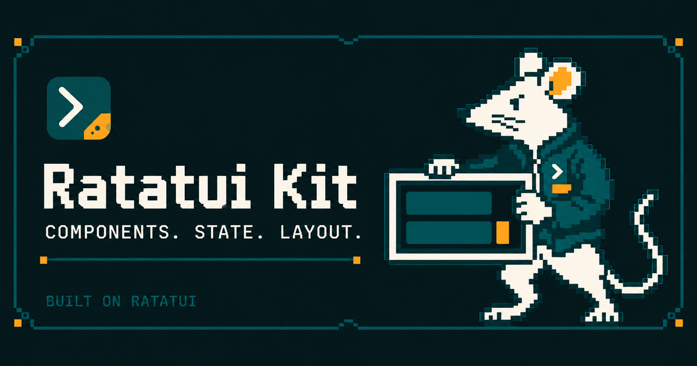

<div align="center">



# Ratatui Kit

**Terminal UI. Composed.**

Build with components. Think in state. A Rust terminal UI framework built on Ratatui and Tokio.

[](https://crates.io/crates/ratatui-kit)
[](https://crates.io/crates/ratatui-kit)
[](https://docs.rs/ratatui-kit)
[](https://yexiyue.github.io/ratatui-kit/)
[](https://github.com/yexiyue/ratatui-kit/blob/main/LICENSE)

**[Documentation](https://yexiyue.github.io/ratatui-kit/start/)** ·
**[Quick Start](https://yexiyue.github.io/ratatui-kit/start/quick-start/)** ·
**[Components](https://yexiyue.github.io/ratatui-kit/components/)** ·
**[Examples](https://yexiyue.github.io/ratatui-kit/examples/)** ·
**[Ecosystem](https://github.com/yexiyue/awesome-ratatui-kit)** ·
**[简体中文](https://github.com/yexiyue/ratatui-kit/blob/main/README.zh-CN.md)**

</div>

---

## Overview

Ratatui Kit adds components, props, hooks, routing, input layers, and theming to Rust terminal applications. Ratatui draws the interface. Tokio drives async work. The framework manages component lifetimes, retained state, and reactive rendering.

- **Describe the interface** with `#[component]` and `element!`. Compose layouts and embed native Ratatui widgets.
- **Organize state** with hooks for local state, futures, and effects. Opt into atoms for shared state.
- **Build the application** with routes, isolated input layers, and palettes that coordinate the whole interface.

The pixel terminal assembler reflects Ratatui’s terminal culture and this framework’s component layer. See the [brand assets](assets/brand/README.md) for the character source and usage guidelines.

### See it running

The website includes real terminal recordings with playback controls. Clone this repository to run the same examples locally:

| Example | Run command | Walkthrough |
| --- | --- | --- |
| Task management | `cargo run --example todo_app` | [Task management](https://yexiyue.github.io/ratatui-kit/apps/todo-app/) |
| Mouse interaction | `cargo run --example mouse` | [Mouse interaction](https://yexiyue.github.io/ratatui-kit/core/pointer-events/) |
| Data tables | `cargo run --example table` | [Data tables](https://yexiyue.github.io/ratatui-kit/components/table/) |
| Routing | `cargo run --example router` | [Routing](https://yexiyue.github.io/ratatui-kit/tutorials/router/) |

<details>
<summary>Table of contents</summary>

- [Features](#features)
- [Quick start](#quick-start)
- [Built-in components and hooks](#built-in-components-and-hooks)
- [Feature flags](#feature-flags)
- [Documentation and examples](#documentation-and-examples)
- [Ecosystem](#ecosystem)
- [Design goals](#design-goals)
- [Contributing](#contributing)
- [License](#license)

</details>

---

## Features

- **Declarative components**: write terminal UI trees with `element!`, including first-class `if`, `if let`, `for`, and `match` control flow inside child blocks.
- **React-style hooks**: use local state, futures, effects, memoized values, context, terminal size, lifecycle cleanup, and input handlers in component functions.
- **State retention by identity**: the runtime reuses component instances across frames using `ElementKey + TypeId`, preserving hook slots and local state when identity stays stable.
- **Waker-driven rendering**: state writes wake the render loop instead of requiring manual redraw calls.
- **Async-native runtime**: the terminal loop runs on Tokio, so components can spawn futures and react to async work naturally.
- **Flex-style layout**: `LayoutStyle` maps common layout concepts (`flex_direction`, `justify_content`, `gap`, `margin`, `offset`, `width`, `height`) to Ratatui layout primitives.
- **Unified theming**: a shared `Palette` is the single color source, and every component derives its styles from it via a per-component `FooTheme`. Recolor globally with `PaletteProvider`, override one component type with `ThemeOverride`, or drive the palette from an `Atom` to re-theme at runtime.
- **Central input routing**: `InputRuntime`, `InputLayer`, `EventScope`, `EventPriority`, and `EventResult` make modals and edit modes block background shortcuts cleanly.
- **Local and global state**: use component-local `State<T>` for local lifetimes and `Atom<T>` for process-wide shared state.
- **Built-in router**: `RouterProvider`, `Outlet`, `routes!`, `use_navigate`, `use_route`, and `use_params` are available behind the `router` feature.
- **Native widget escape hatch**: use `widget(expr)` and `stateful(widget, state)` to embed existing Ratatui widgets directly.
- **Small default dependency surface**: the default feature set is empty; opt into `router`, `atom`, `input`, `tree`, `table`, `virtual-list`, `serde`, or `full` as needed. The theming protocol is always-on with no extra dependency.

---

## Quick start

Install the crate:

```bash
cargo add ratatui-kit
```

Or let Cargo add the `full` feature set:

```bash
cargo add ratatui-kit --features full
```

This writes a dependency entry like:

```toml
[dependencies]
ratatui-kit = { version = "...", features = ["full"] }
tokio = { version = "1", features = ["rt-multi-thread", "macros", "time"] }
```

The default feature set is intentionally empty. Enable only the capabilities you need, or use `full` for examples and prototypes.

### Counter example

```rust,no_run
use ratatui_kit::{
    crossterm::event::{Event, KeyCode, KeyEventKind},
    prelude::*,
    ratatui::{
        layout::{Constraint, Direction, Flex},
        style::{Style, Stylize},
        text::Line,
    },
};

#[tokio::main]
async fn main() {
    element!(Counter)
        .fullscreen()
        .await
        .expect("failed to run the application");
}

#[component]
fn Counter(mut hooks: Hooks) -> impl Into<AnyElement<'static>> {
    let mut count = hooks.use_state(|| 0_u64);

    hooks.use_future(async move {
        loop {
            tokio::time::sleep(std::time::Duration::from_secs(1)).await;
            count += 1;
        }
    });

    let mut exit = hooks.use_exit();
    hooks.use_event_handler(EventScope::Current, EventPriority::Normal, move |event| {
        let Event::Key(key) = event else {
            return EventResult::Ignored;
        };
        if key.kind == KeyEventKind::Press
            && matches!(key.code, KeyCode::Char('q') | KeyCode::Char('Q'))
        {
            exit();
            return EventResult::Consumed;
        }
        EventResult::Ignored
    });

    element!(
        Center(width: Constraint::Length(48), height: Constraint::Length(9)) {
            Border(
                flex_direction: Direction::Vertical,
                justify_content: Flex::Center,
                border_style: Style::new().cyan(),
                top_title: Line::from(" ratatui-kit counter ").cyan().bold().centered(),
                bottom_title: Line::from(" q quit | Ctrl+C exit ").dark_gray().centered(),
            ) {
                Text(text: Line::styled(
                    format!("Counter: {:02}", count.get()),
                    Style::new().green().bold(),
                ).centered())
            }
        }
    )
}
```

Run the example from this repository:

```bash
cargo run --example counter
```

---

## AI-assisted development

Ratatui Kit ships an **AI agent skill** — a packaged knowledge base that teaches your AI coding assistant the framework's real components, props, and hooks, the `element!` macro, input layers, and the router — so you can ask it to *"build me a terminal todo app"* and get code that **compiles and follows the framework's idioms**, instead of guessed APIs.

```bash
npx skills add yexiyue/ratatui-kit --skill ratatui-kit
```

The skill lives in [`skills/ratatui-kit/`](skills/ratatui-kit/) and your assistant consults it automatically. Pair it with the general-purpose `rust-best-practices` and `rust-async-patterns` skills for Rust-level correctness. See [**AI-assisted development**](https://yexiyue.github.io/ratatui-kit/start/ai-skill/) for the full guide.

---

## Built-in components and hooks

README keeps the API overview intentionally compact. See the [documentation site](https://yexiyue.github.io/ratatui-kit/) and [docs.rs](https://docs.rs/ratatui-kit) for signatures and deeper examples.

### Components

| Component | Purpose | Feature |
| --- | --- | --- |
| `View`, `Border`, `Center`, `Fragment` | Layout and container primitives | core |
| `Text`, `WrappedText` | Text rendering and measured wrapping | core |
| `Positioned` | Absolute positioning | core |
| `Modal`, `ConfirmModal`, `AlertModal`, `ShortcutInfoModal` | Modal surfaces with input isolation | core |
| `Select`, `MultiSelect` | Single and multiple selection lists | core |
| `ScrollView` | Scrollable viewport | core |
| `ContextProvider` | Scoped context injection | core |
| `PaletteProvider`, `ThemeOverride` | Theme injection — global palette and per-component overrides | core |
| `Button` | Mouse action button (left Down) | core |
| `Input`, `SearchInput` | Single-line input and search input | `input` |
| `TreeSelect` | Tree selection | `tree` |
| `Table` | Data-driven table with cell-grid borders, wrapping, responsive columns, footer rows, and row/column highlighting | `table` |
| `VirtualList` | Virtualized list rendering | `virtual-list` |
| `RouterProvider`, `Outlet` | Routing container and nested route outlet | `router` |

You can also bridge any native Ratatui widget with `widget(expr)` or `stateful(widget, state)`.

### Hooks

| Hook | Purpose | Feature |
| --- | --- | --- |
| `use_state` | Component-local reactive state | core |
| `use_future`, `use_async_state` | Async tasks and async state | core |
| `use_memo`, `use_effect` | Memoized derived values and side effects | core |
| `use_context` | Read values from the nearest context provider | core |
| `use_palette`, `use_component_theme` | Read the current palette or a resolved component theme | core |
| `use_click` / `use_hover` / `use_drag` / `use_pointer` | Click, hover, drag, pointer events | core |
| `use_event_handler` | Register scoped input handlers | core |
| `use_input_layer` | Create a same-frame input layer handle | core |
| `use_insert_before`, `use_terminal_size` | Insert content before render and read terminal size | core |
| `use_exit`, `use_on_drop` | Exit the application and run cleanup callbacks | core |
| `use_navigate`, `use_route`, `use_params` | Router navigation and route data | `router` |
| `use_atom` | Subscribe to global atoms | `atom` |

### Procedural macros

`element!` · `#[component]` · `#[derive(Props)]` · `routes!` (`router`) · `#[with_layout_style]`

---

## Feature flags

| Feature | Enables | Extra dependencies |
| --- | --- | --- |
| `default` | Nothing (`[]`) | - |
| `router` | `RouterProvider`, `Outlet`, `routes!`, `use_navigate`, `use_route`, `use_params` | `regex` |
| `atom` | `Atom`, `AtomState`, `use_atom` | - |
| `input` | `Input`, `SearchInput`, and the `tui_input` re-export | `tui-input` |
| `tree` | `TreeSelect` and the `tui_tree_widget` re-export | `tui-tree-widget` |
| `table` | `Table`, width-aware wrapping, responsive columns, and grid borders | `unicode-width` |
| `virtual-list` | `VirtualList` and the `tui_widget_list` re-export | `tui-widget-list` |
| `serde` | `Serialize` / `Deserialize` for `Palette` | `serde`, `ratatui/serde` |
| `full` | All optional features above | - |

The `textarea` feature is currently disabled during the Ratatui 0.30 migration because `tui-textarea` does not yet provide a compatible release.

---

## Documentation and examples

- [Learning path](https://yexiyue.github.io/ratatui-kit/start/)
- [Quick start](https://yexiyue.github.io/ratatui-kit/start/quick-start/)
- [Installation and feature flags](https://yexiyue.github.io/ratatui-kit/start/installation/)
- [Hooks](https://yexiyue.github.io/ratatui-kit/core/hooks/)
- [State model](https://yexiyue.github.io/ratatui-kit/core/state/)
- [Theming](https://yexiyue.github.io/ratatui-kit/core/theming/)
- [Routing](https://yexiyue.github.io/ratatui-kit/core/routing/)
- [Built-in components](https://yexiyue.github.io/ratatui-kit/components/)
- [Examples](https://yexiyue.github.io/ratatui-kit/examples/)
- [Simplified Chinese docs](https://yexiyue.github.io/ratatui-kit/zh-cn/start/)

Selected runnable examples:

```bash
cargo run --example counter        # local state + async updates
cargo run --example atom_state     # global atom state
cargo run --example router         # RouterProvider and nested Outlet
cargo run --example modal          # modal input isolation
cargo run --example table          # data table with wrapping + highlights
cargo run --example todo_app       # full workflow: state, input, routing, modals
```

<details>
<summary>All examples (<code>cargo run --example &lt;name&gt;</code>)</summary>

```text
hello_world          counter              async_state          atom_state
router               control_flow         input_mutex          input
search_input         scrollview           wrapped_text         modal
confirm_modal        alert_modal          shortcut_info_modal  select
multi_select         tree_select          table                 virtual_list
virtual_multi_select custom_widget        custom_hook           custom_provider
todo_app
```

Some examples require optional features such as `input`, `tree`, `table`, `virtual-list`, or `router`. Running examples from this repository uses the workspace configuration and enables `full`.

</details>

---

## Ecosystem

Beyond the built-in components, ratatui-kit has a growing ecosystem of third-party
component crates, published independently as `ratatui-kit-<name>`. They depend only on the
stable [Extension API](./EXTENSION_API.md) and do **not** need to be merged into this repo,
so the core stays small.

- **Find components** — search the [`ratatui-kit` keyword](https://crates.io/keywords/ratatui-kit)
  on crates.io, or browse [awesome-ratatui-kit](https://github.com/yexiyue/awesome-ratatui-kit).
- **Write your own** — scaffold from the
  [component template](https://github.com/yexiyue/ratatui-kit-component-template)
  (`cargo generate yexiyue/ratatui-kit-component-template`) and follow the
  [Component Guide](./COMPONENT_GUIDE.md).
- **Official extensions** live in
  [ratatui-kit-contrib](https://github.com/yexiyue/ratatui-kit-contrib) (e.g.
  `ratatui-kit-markdown` — Markdown / code-block / diff / blockquote / divider).

## Design goals

Ratatui Kit is inspired by React, [iocraft](https://github.com/ccbrown/iocraft), and [ink](https://github.com/vadimdemedes/ink), but stays close to Rust and Ratatui:

- **Declarative**: describe what the UI should look like instead of mutating terminal buffers by hand.
- **Reactive**: state changes wake the runtime, and the framework reconciles the component tree for the next frame.
- **Async-first**: timers, IO, and background tasks fit into component lifetimes through Tokio.
- **Composable**: the built-in components stay business-neutral; application-specific behavior belongs in your own hooks, providers, and components.
- **Escape-friendly**: when a native Ratatui widget is the right tool, embed it directly.

---

## Contributing

Issues and pull requests are welcome.

Before sending a PR, run the same validation matrix used by CI:

```bash
cargo fmt --all --check
cargo clippy --all-targets --all-features --workspace -- -D warnings
cargo test --locked --all-features --workspace --lib --tests --examples
RUSTDOCFLAGS="-D warnings" cargo doc --no-deps --document-private-items --all-features --workspace --examples
```

This repository uses lefthook for local pre-commit checks.

---

## License

Ratatui Kit is released under the [MIT License](https://github.com/yexiyue/ratatui-kit/blob/main/LICENSE).

Mouse interactions: `cargo run --example mouse`. Enable capture with `fullscreen_with(RunOptions { mouse: true })`. See [Pointer Events](https://yexiyue.github.io/ratatui-kit/core/pointer-events/).
