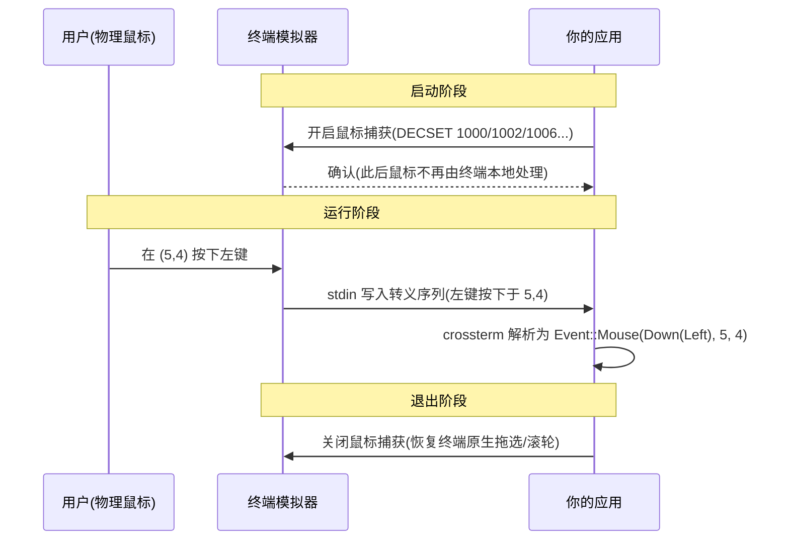
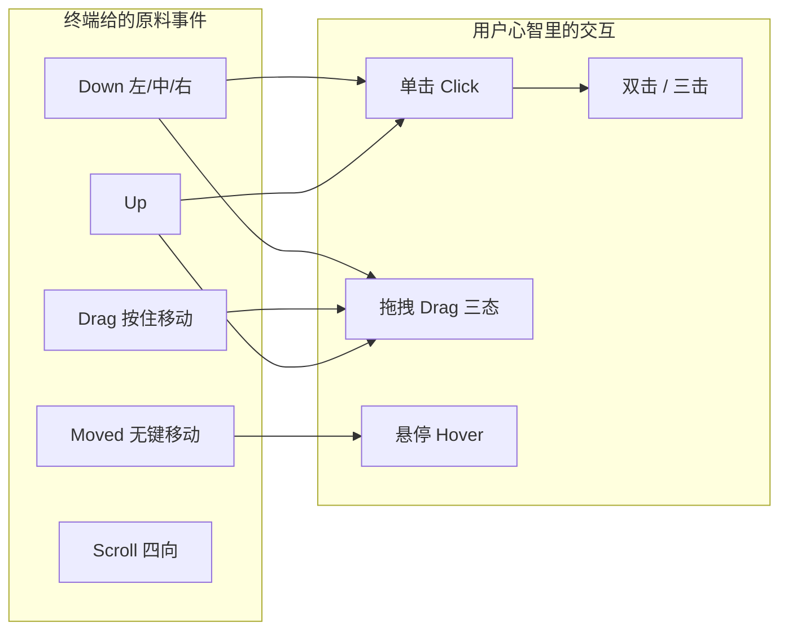
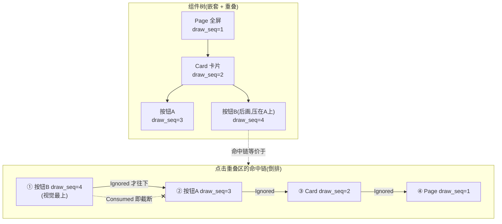
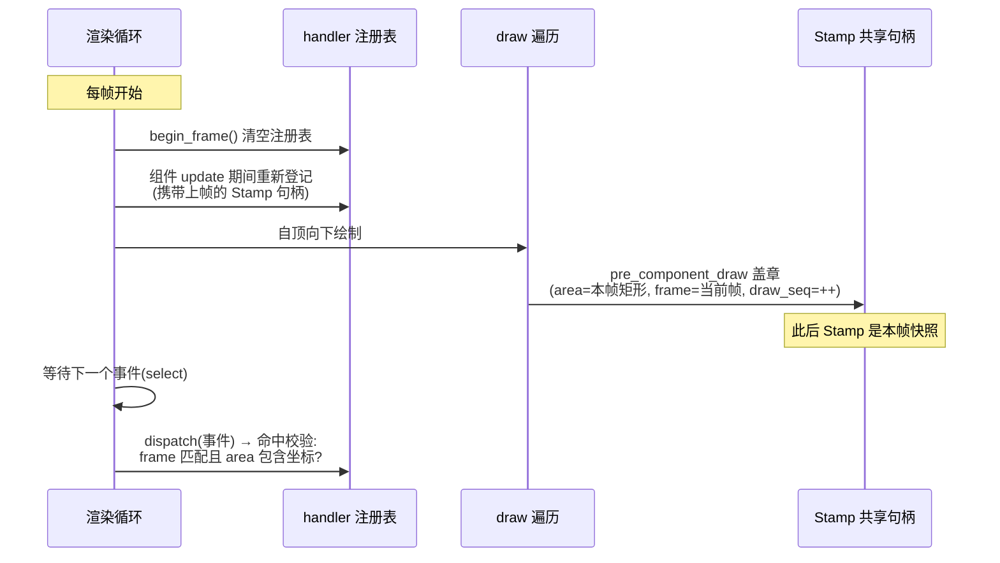
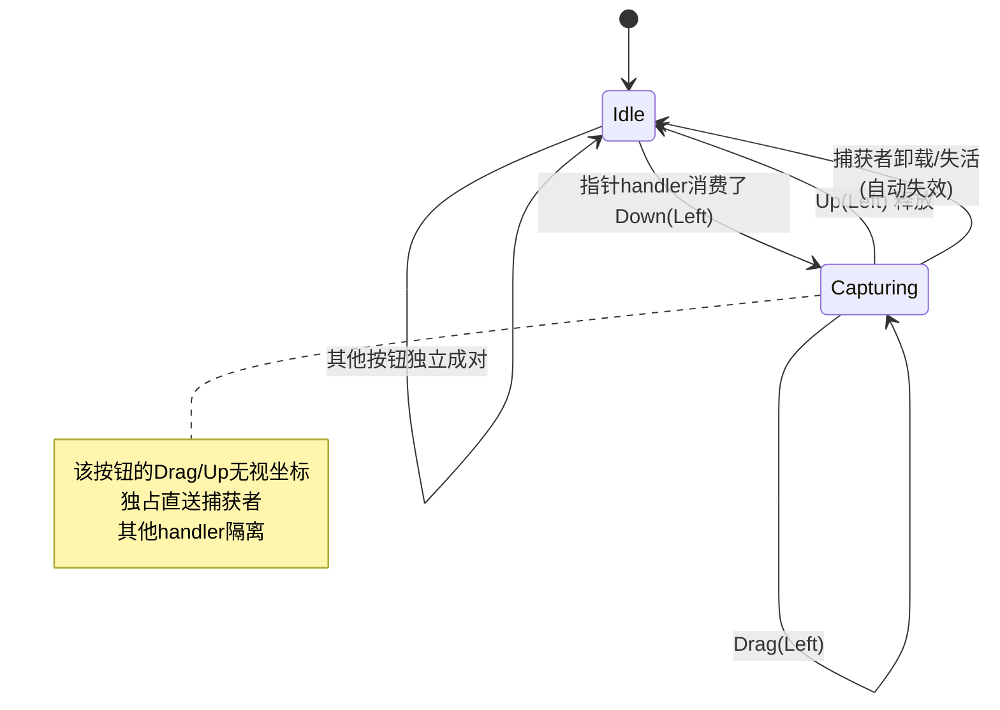
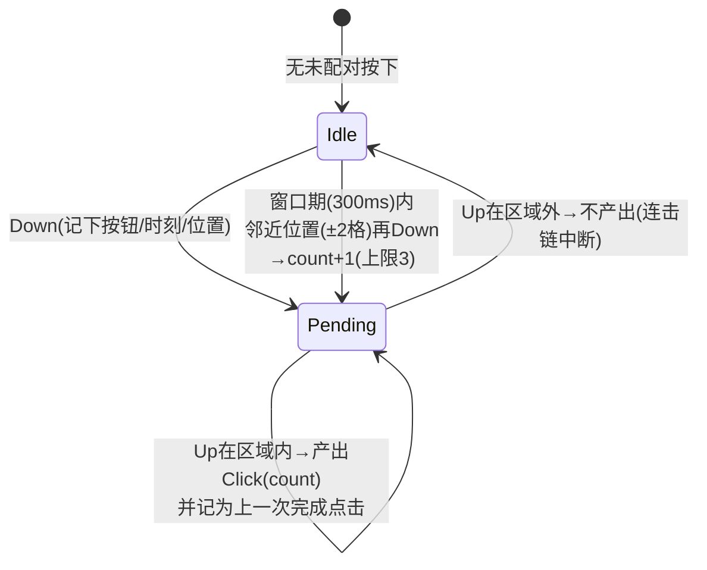
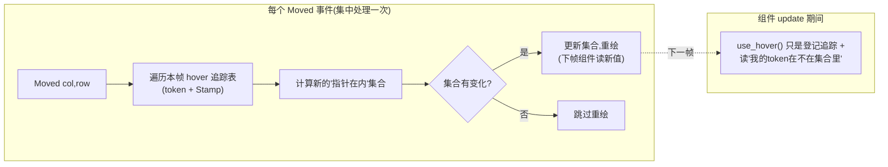
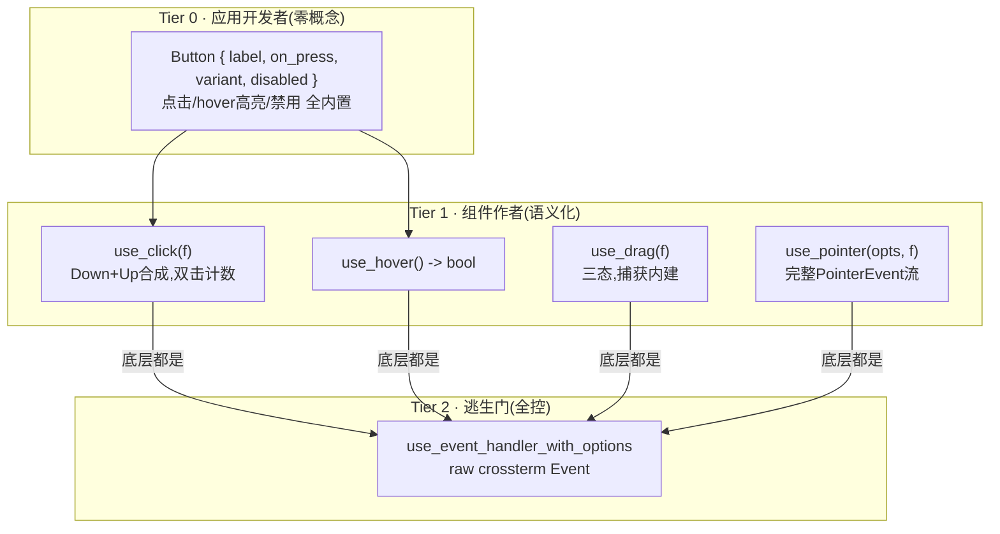
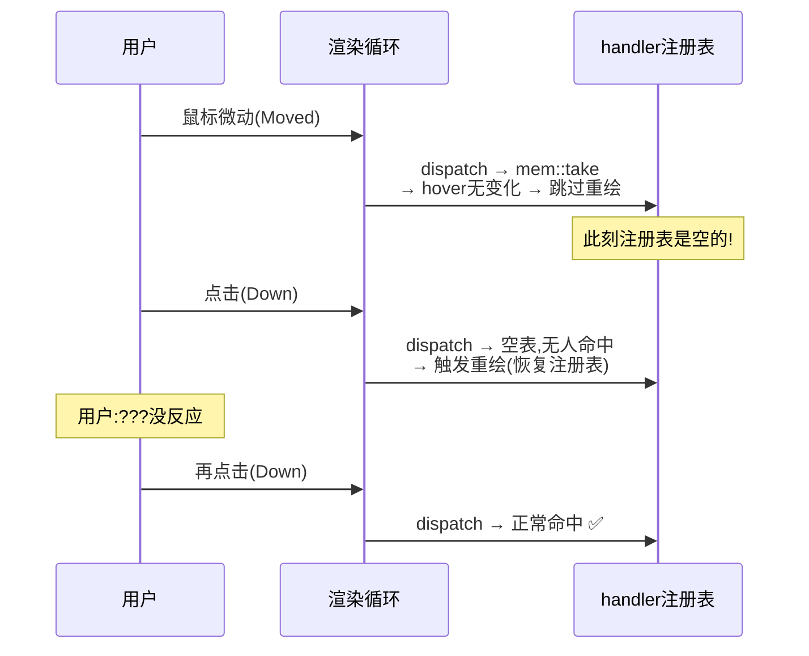

# 让终端 UI 支持鼠标点击:从转义序列到事件冒泡的完整实现

如果你写过一个稍微复杂点的终端应用,一定有过这个念头:**"要是这个按钮能用鼠标点就好了"**。

终端 UI 框架里,键盘交互已经是一件"解决过的问题"——但鼠标不一样。它听起来简单(不就是点击吗),真做起来你会发现一串问题接踵而至:

- 终端怎么把"用户点了鼠标"告诉应用?点击的坐标怎么来?
- 屏幕上有几十个组件,我怎么知道 `(列 19, 行 3)` 点的是哪个按钮?
- 一个按钮嵌在一张卡片里,点按钮的时候,卡片应不应该也收到这次点击?
- "拖拽"怎么表达?按下在 A 组件、拖到 B 组件、松开,这算谁的?
- "双击"是两个单击吗?鼠标划过按钮要高亮,移动事件刷屏怎么办?

这篇博客记录 ratatui-kit 最近落地的鼠标/指针支持(openspec 变更 `add-pointer-events`),从**终端底层协议**讲到**框架分发架构**,把每一个设计决策背后的原理讲清楚。读完你应该能回答上面所有问题。

先看最终效果——用户视角,一切都很"理所当然":

```rust
// 应用入口:显式打开鼠标
element!(App)
    .fullscreen_with(RunOptions { mouse: true })
    .await?;

// 组件里:声明一个可点击按钮
element!(Button(
    label: "删除".to_string(),
    variant: ButtonVariant::Danger,
    on_press: move |()| delete_item(),
))
```

而"理所当然"的背后,是下面这整篇文章。

## 一、从零开始:终端的鼠标是怎么回事

### 1.1 终端只是一个字符网格

首先要建立一个心智模型:在应用眼里,**终端不是一块画布,而是一个 `宽 × 高` 的字符网格**。每个格子能放一个字符、一个前景色、一个背景色。没有像素,没有图层,没有 DOM。

ratatui 的渲染就是每次把整个网格 diff 一遍,把变化的格子写出去。

鼠标也一样——它不是"指针",只是 **`(列, 行)` 两个数字**。

### 1.2 关键前提:默认情况下,应用根本收不到鼠标事件

这是最反直觉的一点。你平时在终端里用鼠标拖选文字、复制粘贴,那都是**终端模拟器(iTerm2 / Windows Terminal / kitty…)自己在处理**,应用全程不知情。

应用想收到鼠标事件,必须先向终端"申请"——发送一条**转义序列**打开"鼠标捕获模式":

```text
应用 → 终端:  \x1b[?1000h\x1b[?1002h\x1b[?1015h\x1b[?1006h   (打开捕获)
应用 → 终端:  \x1b[?1000l...                                (退出时关闭,恢复原状)
```

这些 `?1000h` 之类的编号是 DECSET 私有模式,几个关键的:

| 模式 | 含义 |
|---|---|
| `1000` | 基础:按下/释放时上报 |
| `1002` | 按钮事件追踪:**按住拖动时**也上报移动 |
| `1003` | 任意移动追踪:鼠标**划过**就上报(悬停的前提,事件量大) |
| `1006` | SGR 编码格式(现代标准,坐标不溢出) |

打开之后,鼠标事件就以转义序列的形式混进了**标准输入**,和键盘事件排同一个队。比如"在 (列 5, 行 4) 按下左键"长这样:

```text
\x1b[<0;6;5M      ← SGR 格式:0=左键按下,坐标 1-based
\x1b[<0;6;5m      ← 同位置释放(小写 m = release)
\x1b[<32;10;7M    ← 按住左键拖到 (10,7)(32 = 拖动中的左键)
\x1b[<35;20;8M    ← 无按键移动到 (20,8)(35 = 纯移动)
```

crossterm(ratatui 的后端)负责把这些字节解析成结构化事件交给应用:

```rust
Event::Mouse(MouseEvent {
    kind: MouseEventKind::Down(MouseButton::Left),
    column: 5,      // 0-based
    row: 4,
    modifiers: KeyModifiers::NONE,
})
```

整个链路是这样的:



三个从这里直接推出的工程结论:

1. **不申请就什么都没有。** 这也是为什么很多 TUI 应用的鼠标"没反应"——不是 bug,是根本没开口要。
2. **捕获是"排他"的。** 打开之后,用户原本的拖选、滚轮回溯会被劫持(不同终端的溢出策略不同)。所以 ratatui-kit 把它做成**显式 opt-in**(`RunOptions { mouse: true }`),不开启的应用行为一个字节都不变;退出时必须恢复,否则用户终端"坏掉"了。
3. **逃生门是 Shift。** 几乎所有终端都保留了"按住 Shift 用原生选择"的后门(终端侧行为,应用收不到事件,恰好合理)。

### 1.3 顺带一提:Hover 是"奢侈品"

注意上表的 `1002` 和 `1003`:**按住拖动才上报移动**是默认档,**随便划过就上报**是另一档。

这意味着:如果你只开基础捕获,鼠标悬停是做不了的(没有事件);要 hover 就得开 `1003`,而 `1003` 意味着鼠标每滑过一格就产生一个事件——事件洪泛。这是后面"hover 必须做集中 diff + 跳过重绘"的根源,先按下不表。

## 二、问题定义:坐标到手之后,难的是什么

假设现在 `Event::Mouse(Down(Left), 19, 3)` 已经送到框架手里了。真正的难题才开始。我把它拆成三个:

**难题一:命中——`(19, 3)` 点的是谁?**

框架里的组件是几十个嵌套的盒子:全屏的 View 里装着工具栏,工具栏里装着四个按钮。坐标只是一个点,要回答"这个点落在哪些组件的矩形里、其中谁才是'目标'"。

**难题二:顺序——命中了一串组件,谁先处理?**

按钮在卡片里,卡片在页面里。点按钮,事件在"谁那里停"?这是前端开发者熟悉的问题:**事件冒泡**。DOM 的答案是三阶段模型(capture → target → bubble),那终端 UI 框架要不要照搬?

**难题三:语义——Down/Up/Moved/Drag 只是"原料"**

用户心智里的"点击"是"按下并松开且没挪窝";"双击"是"短时间内在同一位置点了两次";"拖拽"是"按下后移动最后松开"。终端只给原料事件,组合语义要框架来合成——而且要在合成过程中保持难题二的传播规则不乱。



## 三、地基:ratatui-kit 已有的事件系统

ratatui-kit 是一个类 React 的终端 UI 框架(组件 / Props / Hooks / Context)。在鼠标支持之前,它已经有一套相当完整的**键盘事件系统**,理解它是理解后面设计的前提。三个关键机制:

**机制一:中央分发器 + 每帧重建的注册表。**

组件在自己的函数体里"注册"事件处理器,而不是订阅某个总线:

```rust
#[component]
fn Sidebar(hooks: Hooks) -> impl Into<AnyElement<'static>> {
    hooks.use_event_handler(EventScope::Current, EventPriority::Normal, move |event| {
        // 收到任意 crossterm Event(键盘/鼠标/Resize...)
        EventResult::Ignored // 或 Consumed(截断传播)
    });
    // ... 返回 UI
}
```

注册表**每帧清空重建**——每帧 update 开始时 `begin_frame()` 清空,组件 update 期间重新登记。这带来一个非常好的性质:**没有跨帧生命周期**。组件卸载了、弹窗关了,下一帧注册表里自然就没有它了,不存在"忘记取消订阅"的泄漏。

**机制二:输入层栈 + 优先级 + 消费。**

- 输入层(`InputLayer`)表达模态:弹窗开一个 `blocks_lower = true` 的层,背景组件的事件就被截断,不用手写 `if !modal_open` 门控。
- handler 返回 `EventResult::Consumed` 表示"我处理了",**后续 handler 不再收到**——这就是现成的"停止传播"。

**机制三:命中过滤其实已经有了(但是哑弹)。**

注册时可以带 `EventOptions { hit_test: true }`,含义是"鼠标事件只有落在我组件的矩形里才调用我"。ScrollView 的滚轮就是这么做的。

……但是有个尴尬的事实:**整个框架从未开启过终端鼠标捕获**。`Event::Mouse` 在真实运行时根本到不了分发器,`hit_test` 是一门从未开火过的大炮。鼠标支持的第一步反而最简单:入口加 `RunOptions { mouse: true }`,终端初始化时执行捕获、退出时恢复,再把"注册了指针 handler 却没开捕获"做成 debug 断言(防止后人再踩哑弹)。

真正的设计从这里开始。

## 四、核心设计一:绘制序,就是冒泡序

这是整个方案里我最喜欢的一步,先讲清楚问题,再看那个"顺手"的洞察。

### 4.1 现状是"反冒泡"的

同层 handler 的排序规则之一是注册序,而注册序等于 update 的遍历序——**自顶向下,父先于子**。对键盘事件这是合理的(父级快捷键先裁决);但对鼠标命中事件,这意味着:

> 一个全屏的、`hit_test` 的父卡片只要消费了点击,它内部的按钮**永远收不到事件**。

父先于子,恰好是前端所说的**捕获方向**(capture),而不是用户期望的冒泡方向(bubble:最内层的目标先处理,处理不完再交给祖先)。

### 4.2 洞察:draw 遍历天然携带我们需要的信息

前端有 DOM 树可以双向遍历,我们没有——但我们有别的东西。看框架的渲染遍历(每个 `InstantiatedComponent::draw`):

```text
draw(组件):
    回填本组件 hooks 的绘制信息(区域等)     ← 先
    component.draw(把自己画出来)
    for child in children: child.draw(...)   ← 后
```

**父的钩子回填永远先于所有子,兄弟按子列表顺序。** 也就是说,如果我们在回填时给每个 handler 盖一个全局单调递增的"绘制序号" `draw_seq`,那么:

- 子的 `draw_seq` **恒大于**父;
- 后画的兄弟 `draw_seq` 大于先画的兄弟——而后画者在重叠时**正是视觉在上面的那个**。

于是鼠标事件的排序规则只需一行变化:同层 tie-break 从"注册序升序"改成 **"`draw_seq` 降序"**:



这一招同时买到了两件事:

1. **冒泡**:子先收到,`Ignored` 才轮到祖先——"点按钮就是点按钮,点卡片空白才选中卡片"。
2. **重叠正确性**:两个绝对定位组件重叠时,视觉在上者(后画)先收到。原本按注册序排,先注册的反而抢事件,是个潜伏的错误,顺手修掉了。

一个漂亮的推论:**"遮罩点击关闭"不用写任何门控代码**。全屏遮罩注册一个 `hit_test` 的点击关闭 handler,面板作为它的子孙天然先收到;点面板内按钮→按钮 `Consumed`,遮罩收不到;点面板空白→面板 `Ignored`,事件冒泡到遮罩→关闭。行为完全由传播规则涌现。

### 4.3 为什么不照搬前端的三阶段模型?

前端需要独立的 capture 阶段(`addEventListener(..., true)`),是因为监听器可以挂在任意节点且需要"先于目标拦截"的能力。我们评估后的取舍:

- **"先于视觉序"的需求已有两个逃生门**:同层内的 `EventPriority`(优先级仍排在绘制序之前),以及跨层的 z-order(层栈本来就高于一切排序键)。
- 单条"内层优先链 + `Consumed` 截断"已经覆盖全部场景,少一个概念就少一分心智负担。

映射表如下:

| 前端概念 | 本框架对应物 |
|---|---|
| target(最内命中节点) | 命中链第一个 |
| bubble(向祖先传播) | `Ignored` 继续投递 |
| `stopPropagation()` | `EventResult::Consumed`(已有) |
| capture 阶段 | 不做;`EventPriority` / 层 z-order 承担 |
| `document` 级监听 | `EventScope::Global`(已有) |
| `setPointerCapture()` | 见第六章 |

还有一个必须守住的不变量:**键盘事件的排序一个字节都不动**(父先于子对键盘是特性)。所以 `draw_seq` 倒排只对 `Event::Mouse` 生效,并有专门的回归测试。

## 五、核心设计二:Stamp——区域、帧号、绘制序,一次回填

`draw_seq` 从哪来?和命中区域从哪来,是同一个问题。答案是一个小结构 `Stamp`,它挂在每个 handler 上,由**绘制阶段**回填:

```rust
struct Stamp {
    area: Rect,     // 本组件这一帧的矩形(hit_test 用)
    frame: u64,     // 回填时的帧号(防幽灵用)
    draw_seq: u64,  // 帧内单调绘制序(冒泡排序用)
}
```

为什么要在 draw 阶段回填,而不是注册时?因为 **update 期(注册时)不知道布局**——矩形是布局系统在绘制遍历时才计算的。而 draw 期又拿不到 context(框架的刻意分层),所以用一个跨帧共享的 `Rc<Cell<Stamp>>` 句柄:hook 持有它,注册时交给本帧的 handler 条目,draw 时由 `pre_component_draw` 钩子盖章。

一帧的完整生命线:



### 5.1 帧号:一行字段消灭"幽灵命中"

`frame` 字段解决的是一个阴险的边界情况:**组件这一帧没有画,但它上一帧的矩形还在句柄里**。

想象一个被条件隐藏的浮层,隐藏后它的 hook 还活着,`Stamp.area` 还保留着旧矩形。用户点击那块"空气",命中校验若只看矩形,就会触发一个看不见的组件。加上帧号校验(回填帧号 ≠ 当前帧 ⇒ 视作未命中)后,这类幽灵命中被结构性排除,还顺带覆盖了"挂载后从未绘制"的默认值情况。

### 5.2 已知代价:命中区域滞后一帧

事件到来时用的是**上一帧**的矩形(本帧还没画完)。框架的循环结构保证了"两个事件之间必有重绘",所以静态与状态驱动的布局完全无感;唯一能感知到的是"每帧都在动的组件"(比如跟随鼠标的浮层),命中恒差一帧——这是终端网格刷新模型下的固有粒度,记录为已知限制。

## 六、核心设计三:指针捕获——拖拽不许丢事件

现在处理交互语义里最棘手的一条:**拖拽**。

hit_test 有个致命副作用:按下时指针在滚动条里,拖到外面后,后续 `Drag`/`Up` 事件的坐标已经在区域外——**命中过滤直接把它们扔了**。拖拽交互(拉分隔条、滚动条拇指、框选)当场残废。

前端的答案是 `setPointerCapture()`:把后续事件"锁定"投递给某个元素。我们的方案是**隐式捕获**,规则一句话:

> 指针 handler 在命中链中消费了 `Down(按钮)`,即自动捕获该按钮——它的后续 `Drag`/`Up` 绕过命中过滤与排序,**独占直送**这个 handler,`Up` 后释放。



实现上有一个必须绕开的坑:**handler 表每帧重建,捕获身份不能用帧内下标**。捕获要跨帧(Drag 事件在下一帧才来),所以身份锚定在一个随 hook 存活的 `PointerToken` 上——hook 创建时铸造一次、跨帧稳定,handler 条目携带它,运行时记 `(token, 按钮)` 即可。多按钮各自独立(左键拖滚动条时右键还能干别的),组件卸载后 token 找不到对应 handler,捕获自动失效,不悬挂。

被问过"为什么不给用户显式捕获 API":因为**消费即捕获**已经覆盖了所有正当场景——你要拖拽,必然要消费 Down;你不消费 Down,说明你没打算接管这次按压。少一个 API,少一种误用。

## 七、核心设计四:语义合成与 hover 的性能账

### 7.1 点击合成:一个小状态机

"点击"的完整语义:**Down 与 Up 配对,且 Up 仍落在同一组件区域内**。配对天然成立——Down 被消费即捕获,Up 必然回到同一个 handler;只需在 Up 时校验坐标仍在当前屏幕命中区域内(拖出去释放 = 不算点击,前端同理)。连击计数则是经典的"时间窗 + 位置容差"状态机:



两个工程细节:计数的窗口基准是"上一次**完成**的点击"(而不是上一次按下,否则 Up 之后状态就丢了);跨目标不合成靠"Up 仍在区域内"校验兜底。

### 7.2 hover:集中式 diff 是性能的生死线

悬停要开 `1003`(任意移动上报),鼠标每滑一格一个事件。如果每个 `use_hover` 的组件都各自收一遍 Moved 自己算 `contains`,就是 **N 个组件 × M 次移动** 的无谓计算;更糟的是渲染循环"每事件必重绘"的既有行为会让**滑一下鼠标 = 全屏重绘风暴**。

所以 hover 走了完全不同的路——**读状态,不收事件**:



配套的跳过重绘规则推广成了通用的:`dispatch` 返回"是否需要重绘",**Moved 无人消费且 hover 集合无变化 ⇒ 渲染循环直接回等待,不重绘**。这里有个精妙的兜底:如果某个 handler 在 Moved 上写了 state 怎么办?响应式系统的 waker 会立即唤醒渲染循环重绘——跳过的只是"没人需要的重绘",不会漏掉任何真实的变更。

## 八、API 分层:让 90% 的场景一行代码

原理讲完了,落成 API 时我们按"用户离细节的距离"分了三层:



每层的分界是"谁替你做决定":Tier 0 连"消费还是放行"都替你定了(命中即消费,不冒泡);Tier 1 给你语义化的原料(`Click { count, button, position }`、`DragUpdate { phase, from, to }`);Tier 2 你直面 `MouseEventKind`,自己 match。原则是**runtime 只做必须全局的事**(排序、帧戳、捕获路由、hover diff),纯局部语义(连击计数、三态组装)放在 hook 层,核心不膨胀。

## 九、踩坑实录:三个真实 bug 的解剖

这部分是整个开发中最有价值的收获——三个 bug 全都通过了第一轮测试,又全都在真实运行时现形。

### 坑一:hooks 是按"调用序号"索引的,任何钩子实现里 use_hook 必须恰好一次

现象:集成测试里 hover 状态永远读不到,探针显示 **token 每帧都在重新铸造**。

根因:指针 token 的铸造最初写在 `InputRuntime` 上(需要 context),于是 hook 实现里被拆成了"读一次 use_hook 查 token、没有就借 context 铸造、再 use_hook 一次写回"。而框架的 hooks 是**按调用顺序索引**的数组——多调一次就指向下一个槽位。结果每帧命中不同的 hook 实例,token 字段永远是空的。

修复:token 改为线程局部计数器铸造(铸造不需要 context 了),hook 身份与共享状态从**同一次** `use_hook` 调用里取。教训:hooks 的顺序约束不只是用户要遵守的规则,**框架自己写 hook 时是更深的雷区**。

### 坑二:性能优化清空了注册表——"按钮要点两次"

用户报告:点 Reset 按钮第一次没反应,第二次才生效。复现路径极其刁钻:**鼠标移到按钮上(悬停高亮)、原地微动一下、再点击**——必现。

根因链:① `dispatch` 用 `mem::take` 把 handler 表拿走处理,原设计依赖"每个事件之后必有重绘"在下一帧重建注册表;② hover 优化引入了"Moved 无变化 ⇒ 跳过重绘"的路径;③ 两条放一起,跳过重绘的那次 dispatch 之后注册表是**空的**——紧接着的第一次点击对着空表分发,被吞掉(但它会触发重绘、恢复注册表),于是第二次点击才生效。



修复只有一行语义:`dispatch` 处理完把 handler 表**放回去**。正常路径下一帧照常清空重建(行为不变);跳过重绘的路径下,本帧 handler 集继续服务后续事件——这才是"没有重新渲染 ⇒ 还是同一帧"的正确语义。

### 坑三:未启用鼠标也会改终端模式

双轴代码审查发现的:`1003`(任意移动)的惰性升级只检查"有没有人要 hover",没检查"鼠标捕获开没开"。release 构建下,一个没开 `mouse: true` 的应用只要挂了个 Button,框架就会往终端写 `\x1b[?1003h`,而且退出时永远不会撤销——违反了"未启用时行为与现状完全一致"的承诺。修复:升级门控 `mouse_enabled`。

三个坑的共同主题:**框架代码里,"每帧"和"跨帧"的边界是最容易出事的地方**。每帧重建的注册表、跨帧持活的 token 与捕获状态、介于两者之间的 Stamp 回填——每个字段的生命周期想清楚,一半的 bug 就不会出生。

## 十、验证:怎么给"鼠标"写自动化测试

终端交互的自动化测试天然困难,最后分享一下验证策略,三层递进:

1. **runtime 单测**(占大头):注册表、排序、捕获路由、hover diff 全部是纯逻辑,直接构造 handler/Stamp 断言分发结果——命中链顺序、捕获独占、卸载失效、帧戳拒幽灵,每条规则一个测试。
2. **树级集成测试**:一个 `Mounted` 测试 harness 把组件树挂到 `TestBackend`,模拟真实循环节奏(**dispatch 之后必跑一帧 update+draw**——这个节奏本身就是要测的语义),对组件发合成鼠标事件断言回调与渲染。
3. **pty 端到端冒烟**:用伪终端(`pty.fork`)+ 手写 SGR 转义序列注入真实点击/移动/拖拽,再**光标感知地重建屏幕内容**做断言。八个场景全绿:按钮计数、弹窗开合、遮罩关闭、hover 高亮、拖动分隔条(位置 32→16)、退出恢复终端。坑二的复现与修复验证就靠它——单测和集成测试都没能覆盖"微动后点击"这个真实时序。

## 结语

回头看,这套设计里真正"新"的东西其实很少:显式 opt-in、层与优先级、`Consumed` 截断、每帧重建,全是既有键盘事件系统的存量;鼠标支持本质上是往这个存量架构里加了**三个新事实**——绘制序可当冒泡序(`draw_seq`)、帧号可当存在证明(`frame`)、token 可当跨帧身份(`PointerToken`)——再把组合语义(点击/双击/拖拽/hover)作为薄薄的糖放在 hook 层。

已知限制也如实记录:嵌套滚动穿透(内层滚到底滚轮不冒泡,需组件配合返回 `Ignored`)、命中区域不与视觉裁剪求交(溢出被裁剪的子组件仍可命中完整矩形)、点击驱动的键盘焦点环。它们都有清晰的后续路径,留给下一个变更。

完整的设计文档在仓库里:`openspec/changes/add-pointer-events/`(proposal / design / tasks / spec 四件套),实现主要落在 `crates/ratatui-kit/src/input/mod.rs`(分发核心)与 `src/hooks/use_pointer.rs`(语义化 hooks),可运行的例子是 `cargo run --example mouse`。

如果这篇博客让你对"终端 UI 框架的事件层该怎么设计"产生了一点兴趣,欢迎来 [ratatui-kit](https://github.com/yexiyue/ratatui-kit) 逛逛——毕竟,能在终端里点按钮,谁还想按方向键呢?


## 接入后的补充：滚动坐标、悬停与布局

滚动容器内的 widget 使用内容缓冲坐标，不能拿原始终端坐标直接命中。Drawer 现在在内容缓冲栈组合偏移与祖先视口裁剪，Stamp 同时保留绘制区域和屏幕命中区域。`PointerEvent.position` 与 `area` 共用绘制坐标，`screen_position` 保留终端坐标；`use_click` 与 `use_drag` 的坐标仍为终端坐标。这样嵌套滚动中的按钮、列表和输入框无需分别补偏移，隐藏内容也不会接收点击。

滚动条要共享渲染与命中几何。原生 Scrollbar 只绘制；自绘内容用 `use_scrollbar(ScrollbarOptions, on_seek)`，树用 `TreeSelect.scrollbar`，整体内容用 ScrollView。三者共用 ScrollbarStyle，包括 hover_style、drag_style、符号和箭头配置。抓住滑块后消费 Down 捕获对应按键，拖出轨道继续移动；取消只清理临时状态，不当作成功释放。多个面板各自注册即可。

鼠标静止时，布局移动、resize、滚动和输入层变化也会使原悬停失效。InputRuntime 在绘制后同步进入/离开，内置列表和 `use_hover_row` 额外核对最新条目映射，变化后补绘直到收敛。公开 use_pointer 不会每帧无条件伪造 Move，受控状态也只在值变化时写入。

自绘列表加载或空态时可能留下 widget 的旧 hit table，必须检查当前可用性和索引范围。写状态前释放读守卫，尤其不要在 `match state.read().hit_test(...)` 分支中直接写同一 state。手写 Component::update 先连接 updater 的 context stack，保持 Hook 顺序不随 active、on_seek 或外部 state 改变。

ScrollView 的内容、视口、偏移、轨道使用同一 ResolvedLayout；主轴 Percentage/Fill/Ratio 参照原 block.inner，交叉轴参照最终视口，偏移先于子绘制裁剪。padding/底部标题不能冒充边框，ring 滚动条使用 outer 的真实右/下边缘。可复用接入说明见 `skills/ratatui-kit/references/pointer-events.md`。
